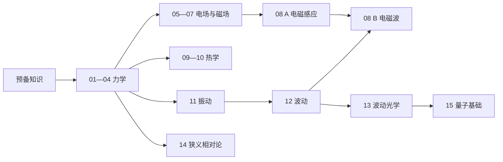

# 大学物理学习网站：课程目录与功能方案

版本：v0.1 · 日期：2026-11-08 · 状态：原始课程与产品设计草案

实现状态（2026-11-09）：已完成15章本地学习站的P0/P1流程与本轮审校。本文保留原始规划语境；实际内容、功能及验证以根目录README.md、本目录PROGRESS.md和CONTENT-REVIEW.md为准。P2账号同步、AI辅导、班级功能尚未实现。

## 1. 网站定位与设计范围

面向学习大学物理的本科生，支持课堂同步、自学和课后巩固。默认采用包含微积分的大学物理深度；具体教学内容可在接入学校教材后映射调整。
学习主线：**理解物理情境 → 建立模型 → 学习概念与公式 → 分析例题 → 独立练习 → 复习薄弱点**。

保留用户提出的 15 章及编号，归为 5 个模块。另设“预备知识”，不占正式章节编号。“热学”以热力学为主；“量子力学”先覆盖大学物理中的量子基础，再提供拓展入口。

本文件定义课程目录、页面结构、功能优先级及验收标准。所有课程内容和网站功能均为待开发规划。

## 2. 课程总览

| 模块 | 章节 | 模块学习目标 |
| --- | --- | --- |
| 力学 | 01 质点运动学；02 牛顿运动定律；03 动量与能量；04 刚体力学 | 从描述运动，过渡到受力、守恒和转动分析 |
| 电磁学 | 05 静电场；06 静电场中的导体和电介质；07 稳恒磁场；08 电磁感应与电磁波 | 理解电磁场、物质响应与时变电磁现象 |
| 热学 | 09 气体动理论；10 热学 | 连接微观统计模型与宏观热力学规律 |
| 振动、波动与光学 | 11 振动；12 波动；13 波动光学 | 从单个振子，理解波的传播、叠加和光学现象 |
| 近代物理 | 14 狭义相对论；15 量子力学 | 理解经典模型的适用范围，建立相对论与量子基础 |

### 预备知识：随用随查

- 单位、量纲、有效数字、数量级估算。
- 矢量的分解、点积、叉积及方向判断。
- 导数、定积分及其物理意义。
- 三角函数、指数函数、复数表示与简单微分方程。
- 概率、概率密度、平均值与分布。
- 场的通量与环流；梯度、散度、旋度作为拓展卡片，不作为所有章节的进入门槛。

每节正文链接到实际需要的数学卡片，避免要求学生先完整学完一套数学课程。

## 3. 各章课程目录

下面的小节编号可直接用于后续内容组织。互动实验是候选设计，开发顺序见第 10 节。

### 第 01 章　质点运动学

- 1.1 质点模型、参考系与坐标系。
- 1.2 位置、位移、路程、速度与速率。
- 1.3 加速度与位置—时间、速度—时间、加速度—时间图像。
- 1.4 直线运动：由运动方程求导，由速度或加速度积分。
- 1.5 曲线运动：切向加速度、法向加速度与圆周运动。
- 1.6 抛体运动及运动分解。
- 1.7 相对运动与伽利略速度变换。

学习目标：能在运动情境、数学表达式和运动图像之间转换。

互动候选：小车运动与三种图像联动；调整初速度和发射角观察抛体轨迹。

### 第 02 章　牛顿运动定律

- 2.1 惯性、惯性参考系与牛顿第一定律。
- 2.2 牛顿第二定律及分量形式。
- 2.3 牛顿第三定律与相互作用力。
- 2.4 重力、弹力、摩擦力与受力图。
- 2.5 连接体、斜面及圆周运动的动力学。
- 2.6 非惯性参考系与惯性力入门。

学习目标：先选研究对象、画受力图，再列运动方程；区分平衡力和相互作用力。

互动候选：斜面上的物体，调整倾角、摩擦系数和外力并观察受力与运动状态。

### 第 03 章　动量与能量

- 3.1 冲量与质点动量定理。
- 3.2 质点系、内外力及动量守恒。
- 3.3 质心与质心运动。
- 3.4 功、功率与动能定理。
- 3.5 保守力、势能与机械能守恒。
- 3.6 碰撞：弹性、非弹性与完全非弹性碰撞。
- 3.7 综合建模：何时使用动力学、动量或能量方法。

学习目标：能说明所选守恒律的适用条件，并判断碰撞过程中哪些量守恒。

互动候选：一维双车碰撞，对比碰撞前后的动量与动能。

### 第 04 章　刚体力学

- 4.1 刚体模型与定轴转动的运动学。
- 4.2 力矩、转动惯量与平行轴定理。
- 4.3 定轴转动定律。
- 4.4 转动动能、力矩的功与功率。
- 4.5 角动量、角动量定理与守恒。
- 4.6 刚体平衡与纯滚动入门。

学习目标：理解质量分布对转动的影响，并区分平动、转动与纯滚动的约束条件。

互动候选：相同质量和半径的圆环、圆盘与实心球沿斜面纯滚动的比较。

### 第 05 章　静电场

- 5.1 电荷、库仑定律与叠加原理。
- 5.2 电场强度：点电荷与连续电荷分布。
- 5.3 电场线、电通量与高斯定理。
- 5.4 利用对称性计算电场。
- 5.5 电场力的功、电势与电势差。
- 5.6 电场与电势的关系、等势面。
- 5.7 带电粒子在静电场中的运动。

学习目标：区分场强与电势，并识别何时能方便地使用高斯定理求场。

互动候选：放置点电荷，叠加显示场强箭头、等势线及选定位置的数值。

### 第 06 章　静电场中的导体和电介质

- 6.1 导体的静电平衡条件与电荷分布。
- 6.2 静电屏蔽、接地及典型导体系统。
- 6.3 电容与常见电容器。
- 6.4 电容器的串联、并联及电路边界条件。
- 6.5 电介质极化与电位移矢量。
- 6.6 电介质中的高斯定理。
- 6.7 电容器储能与电场能量。

学习目标：解释导体和电介质的不同响应；区分接电源与断开电源时插入电介质的变化。

互动候选：平行板电容器切换“电压保持不变”和“电荷保持不变”，观察电容、场强与储能。

### 第 07 章　稳恒磁场

- 7.1 稳恒电流衔接：电流、电流密度、电荷守恒和欧姆定律。
- 7.2 磁感应强度、磁场线与磁通量。
- 7.3 毕奥—萨伐尔定律及直导线、圆电流的磁场。
- 7.4 磁场的高斯定理与稳恒条件下的安培环路定理。
- 7.5 洛伦兹力及带电粒子在磁场中的运动。
- 7.6 安培力、载流线圈的磁矩与磁力矩。
- 7.7 磁介质基础：顺磁、抗磁与铁磁现象。

学习目标：理解电流产生磁场，以及磁场如何作用于运动电荷和载流导体。

互动候选：改变电荷符号、速度与磁场方向，观察轨迹及力的方向。

范围说明：稳恒电流作为本章衔接内容；复杂直流网络与交流电路可另设拓展，不新增正式章节。

### 第 08 章　电磁感应与电磁波

**A 段：电磁感应，可在第 07 章后学习。**

- 8.1 电动势与电源做功的基本含义。
- 8.2 磁通量变化、法拉第电磁感应定律与楞次定律。
- 8.3 动生电动势与感生电动势。
- 8.4 自感、互感与磁场能量。
- 8.5 涡旋电场及电磁感应的能量分析。

**B 段：电磁波，建议学习第 12 章的波动基础后深入。**

- 8.6 位移电流与麦克斯韦方程组的积分形式。
- 8.7 电磁波的产生、传播及真空中平面波的基本关系。
- 8.8 电磁波能量、电磁波谱与典型应用。

学习目标：用磁通量变化判断感应效应，理解时变电磁场与电磁波的联系。

互动候选：磁铁与线圈的相对运动；真空平面电磁波中电场、磁场和传播方向的关系。

### 第 09 章　气体动理论

- 9.1 理想气体的微观模型与状态方程。
- 9.2 压强的微观解释。
- 9.3 温度、平均平动动能与热运动。
- 9.4 自由度、能量均分与理想气体内能。
- 9.5 麦克斯韦速率分布及三种特征速率。
- 9.6 分子碰撞、平均自由程与输运现象概念。

学习目标：从微观统计解释压强、温度和内能，区分单个分子的运动与整体分布。

互动候选：改变温度和分子质量，比较速率分布曲线；粒子动画与统计分布分开展示。

### 第 10 章　热学（以热力学为主）

- 10.1 热平衡、温度、热量与内能。
- 10.2 准静态过程、热力学功与 p–V 图。
- 10.3 热力学第一定律。
- 10.4 理想气体的等温、等容、等压与绝热过程。
- 10.5 循环过程、热机与制冷机。
- 10.6 热力学第二定律与卡诺循环。
- 10.7 熵、熵变与熵增加原理。

学习目标：结合过程条件与状态变化进行能量分析，理解过程方向与热机效率限制。

互动候选：构造理想气体过程，在 p–V 图上联动显示功、热量与内能变化。

范围说明：第 09 章负责微观解释，本章负责宏观过程和规律。导热、热膨胀与相变可作为补充专题。

### 第 11 章　振动

- 11.1 简谐振动模型、运动方程及初始条件。
- 11.2 振幅、周期、频率与相位。
- 11.3 弹簧振子、单摆及小振幅条件。
- 11.4 简谐振动的能量。
- 11.5 同方向振动的合成与拍。
- 11.6 阻尼振动、受迫振动与共振。

学习目标：能由初始条件确定振动，并用相位和能量描述运动。

互动候选：弹簧振子与位移、速度、加速度、能量图像联动；受迫振动频率扫描。

### 第 12 章　波动

- 12.1 机械波的形成、横波与纵波。
- 12.2 行波表达式、传播方向与相位。
- 12.3 波速、波长、频率与介质性质。
- 12.4 波的能量、能流与强度。
- 12.5 叠加原理、干涉与相干条件。
- 12.6 驻波、边界条件与正常模式。
- 12.7 多普勒效应及声波应用。

学习目标：区分介质质点的振动与波形传播，并用相位差解释干涉和驻波。

互动候选：固定观察某个介质质点，同时观察整列波的传播；两列波叠加形成驻波。

### 第 13 章　波动光学

- 13.1 光程、光程差与相干光。
- 13.2 杨氏双缝干涉。
- 13.3 薄膜干涉、劈尖与牛顿环。
- 13.4 惠更斯—菲涅耳原理与单缝衍射。
- 13.5 光栅衍射与分辨本领。
- 13.6 偏振、马吕斯定律与布儒斯特定律。
- 13.7 干涉与衍射的综合比较及实验分析。

学习目标：从光程差、相位差和边界条件解释条纹，区分干涉、衍射和偏振。

互动候选：调整波长、缝距、缝宽和屏距，联动显示条纹及光强曲线。

范围说明：反射、折射和几何光学基础通过预备卡片补充；透镜成像系统作为拓展专题。

### 第 14 章　狭义相对论

- 14.1 经典时空观的局限与狭义相对论的两个基本假设。
- 14.2 同时性的相对性与洛伦兹变换。
- 14.3 时间延缓、固有时与长度收缩。
- 14.4 相对论速度变换。
- 14.5 相对论动量、能量及能量—动量关系。
- 14.6 时空图、典型问题与低速极限。

学习目标：明确事件、参考系和测量定义，避免脱离条件套用时间延缓和长度收缩公式。

互动候选：光钟与两个参考系中的事件对照；速度参数限制在小于光速的范围内。

### 第 15 章　量子力学（大学物理基础层）

- 15.1 黑体辐射与能量量子化。
- 15.2 光电效应、光子与康普顿效应。
- 15.3 德布罗意物质波与波粒二象性。
- 15.4 波函数、概率密度与归一化。
- 15.5 不确定关系及其物理含义。
- 15.6 薛定谔方程与定态的基本概念。
- 15.7 一维无限深势阱与能级量子化。
- 15.8 势垒隧穿、原子能级与量子现象概览。

学习目标：用概率描述和离散能级理解微观现象，区分波函数与概率密度。

互动候选：一维无限深势阱的能级、波函数与概率密度；光电效应的频率与光强比较。

拓展入口：量子谐振子、氢原子、自旋、算符与本征态。完整的专业量子力学课程应作为后续独立课程设计。

## 4. 先修关系与学习路径

目录保留 01—15 的教材式顺序，同时提供“建议先修”和“返回补习”入口，不强制锁章。

| 学习内容 | 建议先修 | 网站处理方式 |
| --- | --- | --- |
| 第 02 章 | 第 01 章；矢量分解 | 从受力分析链接回加速度和分量 |
| 第 03—04 章 | 第 01—02 章；功与积分 | 在守恒条件和力矩处加入回顾卡 |
| 第 05—06 章 | 矢量、积分；第 03 章的功与势能 | 明确“场”和“能量”两条关联 |
| 第 07 章 | 第 02 章；电荷、电场及电流基础 | 在 7.1 补齐稳恒电流 |
| 第 08 章 A 段 | 第 05—07 章 | 支持按原目录连续学习 |
| 第 08 章 B 段 | 第 08 章 A 段；第 12 章的波动基础 | 首次进入时提示先修，也可先读概览 |
| 第 09—10 章 | 第 03 章；概率与平均值基础 | 把微观模型与宏观过程互相链接 |
| 第 11—12 章 | 第 01—03 章；三角函数与简单微分方程 | 从振子过渡到行波与叠加 |
| 第 13 章 | 第 12 章；反射、折射基础 | 第 08 章 B 段作为电磁背景链接 |
| 第 14 章 | 第 01、03 章 | 以经典结果作低速极限比较 |
| 第 15 章 | 第 03、12—13 章；概率与复数基础 | 在康普顿效应等处链接第 14 章 |

推荐自学路径分为几条可衔接的支线：

图中的分支表示推荐关系。学生仍可按学校进度学习，也可直接查阅某个知识点。

## 5. 每节课的统一结构

| 顺序 | 内容区块 | 必须解决的问题 |
| --- | --- | --- |
| 1 | 学习目标与先修提示 | 这一节要学会什么？缺少什么基础？ |
| 2 | 现象或问题引入 | 为什么需要这个概念或定律？ |
| 3 | 模型、概念与假设 | 研究什么对象？忽略什么因素？ |
| 4 | 公式及必要推导 | 量如何定义？公式如何得到？何时适用？ |
| 5 | 典型例题 | 如何选择方法、建立方程并检验结果？ |
| 6 | 互动探究（适用时） | 改变一个条件会发生什么？ |
| 7 | 随堂练习 | 能否独立理解、计算并迁移？ |
| 8 | 小结与后续连接 | 记住什么？容易混淆什么？接下来学什么？ |

内容设计建议：每节安排 1—2 道例题、3—5 道随堂练习；这是编写起点，按知识点复杂度调整。练习覆盖概念判断、基础计算和条件变化，先讲解再练习。

公式卡必须包含：公式、物理意义、符号定义、单位、标量或矢量属性、适用条件、常见误用，以及返回正文的链接。

例题解析采用统一步骤：明确对象与过程 → 作图 → 选择规律并说明条件 → 列式求解 → 检查量纲、方向、极限或数量级。

## 6. 页面结构与导航

顶部主导航建议为：**课程 · 互动实验 · 公式速查 · 我的学习**，并提供全站搜索。桌面端学习页采用侧边章节目录；移动端收起目录，让正文优先。

| 页面 | 核心内容 | 主要操作 |
| --- | --- | --- |
| 首页 | 继续学习、5 个课程模块、建议复习入口 | 继续上次小节；进入课程 |
| 课程总目录 | 15 章、各章小节、先修说明、内容发布状态 | 展开章节；按模块筛选 |
| 章节概览 | 本章目标、知识结构、小节列表、章末练习 | 开始本章；选择小节 |
| 小节学习页 | 正文、公式、例题、练习、关联实验 | 作答；记录笔记；标记已学 |
| 练习与章末测验 | 按章、知识点、难度组织的题目及反馈 | 提交答案；分级提示；订正 |
| 互动实验室 | 实验目录、参数控制、观察任务与模型说明 | 调参；暂停；复位；返回课程 |
| 公式速查 | 公式及适用条件，按章节和关键词检索 | 收藏；跳转推导或例题 |
| 我的学习 | 学习记录、错题、收藏、笔记 | 继续学习；重做错题；管理记录 |

小节学习页从上到下：面包屑与标题 → 学习目标 → 正文与例题 → 互动探究 → 随堂练习 → 小结 → 上一节／下一节。桌面端可在右侧显示本页锚点与关键公式；窄屏时改为按钮入口。

未发布的小节明确标记“待更新”，不显示虚假学习进度，不使用空按钮伪装已完成功能。

## 7. 网站功能与优先级

P0 是首个可用版本；P1 在学习流程稳定后加入；P2 按实际使用反馈扩展。

| 功能 | 优先级 | 具体范围与交互 |
| --- | --- | --- |
| 课程目录与正文 | P0 | 模块、章节、小节三级结构；正文支持数学公式、插图和关联知识链接 |
| 公式与关键词搜索 | P0 | 搜索已发布的标题、术语、公式名称和标签；支持“动能定理”等中文名称 |
| 例题与分级提示 | P0 | 先显示题目；依次展开思路、关键关系和完整解析 |
| 随堂练习与判分 | P0 | 单选题和数值题；给出正确答案、解释及关联知识点 |
| 基础错题复习 | P0 | 错题可重做，保留尝试记录；可自行标记“待复习／已理解” |
| 学习记录 | P0 | 记录上次位置、主动标记的已学小节和练习结果；首版本地保存，支持导出与导入 |
| 响应式与基本无障碍 | P0 | 手机可读、键盘可操作、控件有标签，图示有文字说明 |
| 首个互动实验 | P0 | 只先实现“匀加速直线运动与三种图像联动”，嵌入对应小节 |
| 章末测验与综合题 | P1 | 覆盖多个知识点；显示各知识点表现，综合推导题提供自评参考 |
| 公式收藏与个人笔记 | P1 | 支持按小节关联，能从笔记返回原文 |
| 更多互动实验 | P1 | 优先补充碰撞、电场叠加、简谐振动和双缝干涉 |
| 知识关系与复习建议 | P1 | 依据真实先修关系和做题记录推荐复习，不将浏览次数当作掌握证据 |
| 账号与跨设备同步 | P2 | 在确有多设备需求后加入，明确区分本地记录与同步记录 |
| AI 学习辅导 | P2 | 基于已校核课程内容提供解释和提示；评分规则与已审核解析保持独立 |
| 教师与班级功能 | P2 | 按后续需求加入作业发布、班级管理和学情查看 |

### 学习记录的含义

- “已读／已学”由学生主动标记，表示完成阅读或学习。
- “练习正确率”来自作答记录，保留题量及是否查看提示的上下文。
- “待复习”来自错题或学生主动选择。
- 首版不将这些指标合成一个看似精确的“掌握度百分比”。

### 题目与判分设计

- 每题绑定知识点、难度、题型、正确答案、解析、提示和常见错误。
- 数值题按题目定义绝对／相对误差、单位和有效数字要求；零值答案使用绝对误差。
- 单位通过受控选择或明确的输入格式处理；方向、正负号和矢量分量按题目规则判定。
- 练习允许重做，但保留首次作答与后续订正；测验模式在交卷后给出解析。
- 推导题和开放题先采用参考解答与自评标准；自动等价公式判定留待后续验证。

## 8. 互动实验的统一标准

每个实验由“观察任务、模型假设、可调参数、动态图示、数值／图像、解释与课程链接”组成。使用前先给出一个可以验证的问题，例如“加速度变为原来的两倍，速度—时间图像如何变化？”

- 控件提供参数名称、单位、范围和当前值；支持键盘调整。
- 运动类实验提供开始、暂停、单步和复位；参数变化后的重置或保留规则明确。
- 展示关键数值，使学生能检验图像，避免只凭动画判断结论。
- 区分真实物理量和为了显示而缩放的量，标注理想化假设。
- 动画可以暂停，不能只依赖颜色区分物体或曲线。
- 匀加速模型注明加速度恒定；抛体模型注明均匀重力场及忽略空气阻力。
- 气体动画注明粒子数、维度和理想化边界，不把少量二维粒子动画直接当作三维理论的精确验证。
- 电磁波展示限定在所述模型中；真空平面行波的电场和磁场同相，二者都垂直于传播方向。
- 量子图示明确区分波函数和概率密度，不能把概率云画成确定的经典粒子轨道。

## 9. 内容组织与编写规则

为便于后续开发与修订，课程内容与页面呈现分别维护，采用稳定标识关联。

| 内容对象 | 需要保存的信息 |
| --- | --- |
| 模块 | 标识、名称、简介、排序 |
| 章节 | 标识、所属模块、编号、标题、目标、先修、发布状态 |
| 小节 | 标识、所属章节、编号、标题、正文、关联知识点、公式、例题与练习 |
| 知识点 | 标识、名称、同义词、先修关系、相关内容 |
| 公式 | 标识、表达式、符号、单位、适用条件、来源小节 |
| 题目 | 标识、知识点、题型、难度、题干、答案、判分规则、提示与解析 |
| 实验 | 标识、关联小节、模型假设、参数、观察任务与解释 |
| 学习记录 | 内容标识、已学标记、阅读位置、作答记录、复习状态、更新时间 |

标识示例：章节 `ch01`，小节 `ch01-s03`，知识点 `constant-acceleration`。显示标题可以修改，稳定标识不随标题改动。

内容校核重点：

- 每次使用守恒律都说明系统和条件；特别区分动量守恒与机械能守恒。
- 全站统一热力学符号约定：采用 `ΔU = Q − W`，其中 `W` 表示系统对外做功；正文显式说明。
- 法拉第定律的负号关联回路与面积法向的约定，方向判断配图。
- 电势零点、势能零点、坐标正方向、初始条件和边界条件表述清楚。
- 力学、热学、电磁学中的同名字母可能含义不同，公式卡按上下文解释。
- 图表注明坐标、单位、方向、控制变量及适用模型；例题核对量纲、数值和极限情况。
- 记录参考资料与修订日期；教材章节映射与原创讲解分开维护。

## 10. 开发顺序与验收标准

### 阶段一：完成一条真实的学习流程

建设课程总目录和通用小节页，完整编写第 01 章，加入基础搜索、练习、错题、本地学习记录及一个匀加速运动实验。其他章节仅展示已规划目录和待更新状态。

验收场景：

1. 从目录进入“1.3 加速度与运动图像”，阅读公式、例题并完成练习。
2. 答错后能看到对应解释、加入待复习列表并重做；重新打开浏览器后记录仍在。
3. 在实验中设置初位置 0 m、初速度 2 m/s、加速度 1.5 m/s²，4 s 后应得到位移 20 m、速度 8 m/s；三种图像与该结果一致。
4. 搜索“加速度”可找到对应已发布小节、相关公式或术语，并说明结果类型。
5. 手机端正文、公式与输入控件可正常阅读和操作；宽公式在自身容器中横向滚动。
6. 导出学习记录后可以导入恢复；清除浏览器数据会移除本地记录的事实在记录管理处说明。

### 阶段二：扩展课程与复习体验

沿用已验证模板，先完成第 02—04 章，再分批编写电磁学、热学、振动与波动光学。补充章末测验、公式收藏、笔记和高价值实验。

验收标准：每个发布章节均有完整目标、正文、例题、练习与小结；不以仅有目录或动画作为章节完成依据。

### 阶段三：覆盖全部 15 章并按使用反馈扩展

补齐相对论与量子基础，核对跨章节先修链接和符号，开展整站内容审阅。账号同步、AI 辅导和班级功能按实际需求单独排期。

以上为开发先后顺序，不预设工期。工期应在确定开发资源、内容来源和首批发布深度后估算。

## 11. 参考与课程范围校对

以下公开教材用于核对大学物理的常见主题范围。本文的 15 章组织、小节划分与产品优先级是针对本项目提出的设计方案，并非照搬教材目录或学校统一大纲。

- [OpenStax《University Physics》Volume 1 前言与课程范围](https://openstax.org/books/university-physics-volume-1/pages/preface)：用于核对力学、振动与波动主题。
- [OpenStax《University Physics》Volume 2 前言与课程范围](https://openstax.org/books/university-physics-volume-2/pages/preface)：用于核对热力学、电磁学主题。
- [OpenStax《University Physics》Volume 3 前言与课程范围](https://openstax.org/books/university-physics-volume-3/pages/preface)：用于核对光学与近代物理主题。
- [OpenStax 第 7 章 Quantum Mechanics 章节概览](https://openstax.org/books/university-physics-volume-3/pages/7-introduction)：用于校对量子基础层的深度定位。

后续接入实际使用的中文教材时，应建立“教材章／节 → 本站知识点”的映射，并根据学校教学要求调整必修和拓展内容。
